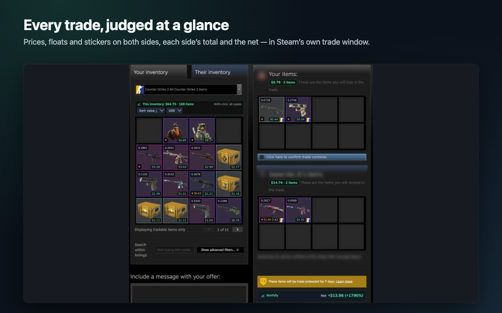

# Chrome extensions by Aslan

Small, private Chrome extensions that each solve one problem well. No accounts, no subscriptions, no ads, no tracking: your data stays on your device.

**Source of this page:** [github.com/7aslann7/extensions](https://github.com/7aslann7/extensions) · **Support:** [aslantnh@gmail.com](mailto:aslantnh@gmail.com)

| | Extension | Status | |
|:-:|---|---|---|
|  | **SkinTally** — your CS2 inventory and every trade, priced: what you'd actually pocket on each market, right inside Steam. | Live | [Chrome Web Store](https://chromewebstore.google.com/detail/dffchhcnaljdmddaaenngdcdldgmcakd) · [Details](skintally/) · [Privacy](skintally/privacy-policy) |
|  | **Form Autofill** — fill the same web forms in one click, or automatically when the page opens, with your own rules. | Live | [Chrome Web Store](https://chromewebstore.google.com/detail/form-autofill-one-click-f/efdijodppmlpcmiliobpfojihojdhncf) · [Privacy](privacy-policy) |
|  | **Auto Refresh** — reload tabs on a timer and get an alert when a page shows or loses the text you're waiting for. | Unpublished | [Privacy](privacy-policy) |
|  | **Tab Vault** — save all your tabs in one click and restore them anytime, built so they are never lost. | On hold | [Privacy](privacy-policy) |

## SkinTally

Everyone shows prices. SkinTally shows what you'd actually pocket. It adds a clean value layer to Steam's own pages, and Steam's interface stays exactly as it is.

- **Inventory:** every item's price, float and sticker value on the grid, your total and if-sold-today net, and a side-by-side of what you'd keep on the Steam Market, Skinport, CSFloat, Buff163, DMarket, Waxpeer and CS.MONEY.
- **Trade offers:** prices, floats and stickers on both sides, each side's total and the net difference. Sort both inventories by price or float, and add every copy of an item with Shift+click. Your trade offers list shows what each offer is worth before you open it.
- **Steam Market case pages:** every possible skin with its price and its range across wears.
- **Selling helpers:** list on the Steam Market in one click with Steam's exact fee. You confirm every listing yourself; nothing is ever sold, accepted or declined automatically.
- **Private by design:** no server, no account, no analytics. Only anonymous price and exchange-rate requests; everything else goes only to Steam, from your own browser.

[Get it on the Chrome Web Store](https://chromewebstore.google.com/detail/dffchhcnaljdmddaaenngdcdldgmcakd) · [More screenshots and details →](skintally/)

## Form Autofill

- Fill a form once, then **Save this form**: next time it fills in one click, with **Alt+Shift+F**, from the right-click menu, or automatically when the page opens.
- Rules per site or for a single page; the more specific rule wins.
- Never reads or fills password fields and never saves card numbers. No daily limit, no subscription.

## Auto Refresh

*Not on the Chrome Web Store at the moment.*

- Reload any tab on a timer.
- Watch for a piece of text and get an alert when it appears or disappears (stock, prices, results, appointments).
- Works only on the tabs you choose; the page text is checked on your device and never stored.

## Tab Vault

*On hold; not published yet.*

- Save every open tab in one click and restore them anytime, in groups.
- Built not to lose data: undo, a 30-day trash and a backup before every update.
- Tabs from private (incognito) windows are never saved.

## How these extensions are built

- **One purpose each**, and only the permissions that purpose needs. Site access is requested when you need it and can be removed anytime.
- **Your data stays on your device.** No accounts, no analytics, no selling or sharing of data.
- **Readable code:** the packages are not obfuscated, so anyone can check what they do.
- **No ads and no affiliate steering.**

## Privacy

- [Privacy policy](privacy-policy) for Form Autofill, Auto Refresh and Tab Vault · [Gizlilik politikası](gizlilik-politikasi)
- [SkinTally privacy policy](skintally/privacy-policy) · [SkinTally gizlilik politikası](skintally/gizlilik-politikasi)

SkinTally is not affiliated with Valve or Steam. Steam and Counter-Strike are trademarks of Valve Corporation.
