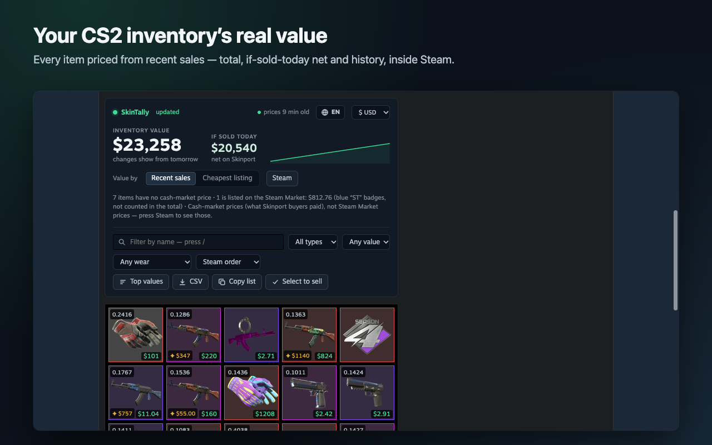
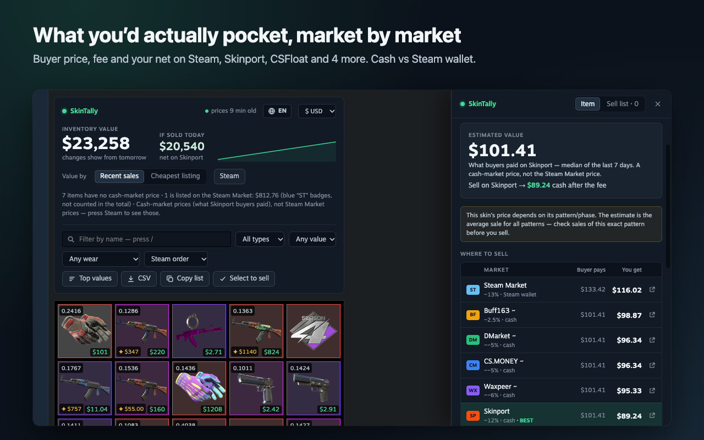
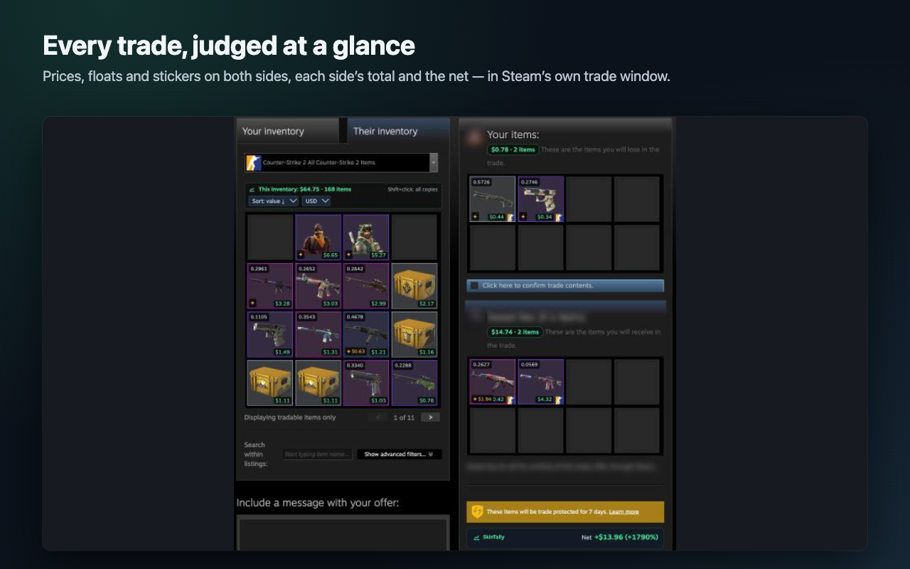
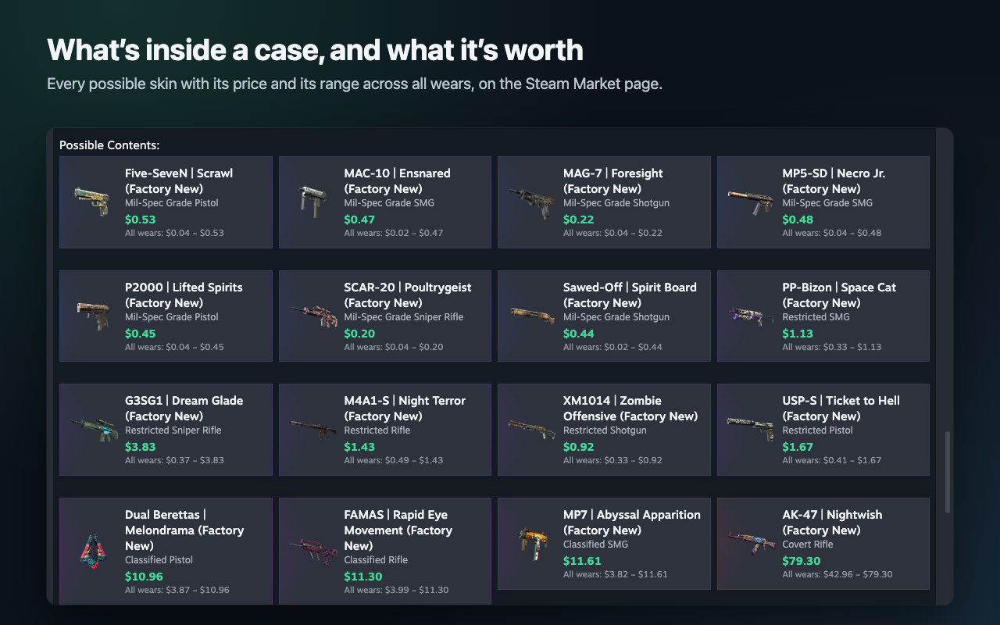
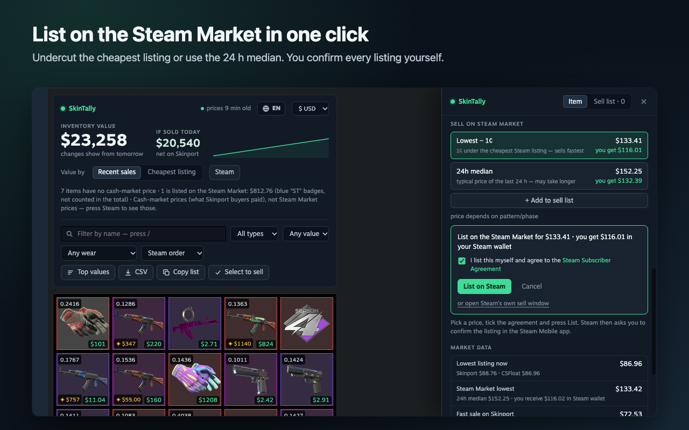

# SkinTally

**Everyone shows prices. SkinTally shows what you'd actually pocket.**

A free Chrome extension for Counter-Strike 2 players. It adds a clean value layer to Steam's own pages (your inventory, the trade offer window, your trade offers list and the Market pages of cases), and Steam's interface stays exactly as it is.

**Status:** coming soon to the Chrome Web Store.

## Your inventory

Every item shows its price, float and sticker value right on the grid, with your total, an if-sold-today net and daily history. Click an item to compare the Steam Market, Skinport, CSFloat, Buff163, DMarket, Waxpeer and CS.MONEY side by side: what the buyer pays, the fee and what you'd keep. Steam wallet money and real cash are kept apart.

## Trade offers

- Every item on both sides shows its price, float and sticker or charm value, your partner's items too.
- Each side is totalled next to Steam's own headings; above "Make Offer" you see the net difference in money and percent, with a warning when you're giving away unpriced, rare-phase or pattern-based items.
- Sort either inventory by price or float, switch currency on the spot, and Shift+click to add every copy of an item at once.
- Your trade offers list shows what each offer gives, what it takes and the difference, before you open it.

SkinTally never accepts, declines or sends a trade for you.

## Case pages on the Steam Market

Under "Possible contents", every skin shows its price and its price range across all wears.

## Selling on the Steam Market

Pick "1¢ under the cheapest listing" or "24 h median", see exactly what lands in your wallet (Steam's own fee formula) and list it in one click, or build a sell list of up to 20 items. You tick Steam's agreement yourself, every listing still needs your confirmation in the Steam Mobile app, and nothing is ever sold automatically.

## Why you can trust it

- Your inventory, trades and costs never leave your browser. There is no SkinTally server, no account and no analytics.
- Read-only on trades and on the Market: it never accepts, declines, buys or places orders.
- Anonymous requests only: prices from Skinport and CSFloat, exchange rates from the Central Bank of the Republic of Türkiye. Everything else goes only to Steam, from your own browser, just like the page itself.
- Minimal permissions: storage plus those three price and rate sites, and it runs only on Steam's inventory, trade and Market pages.
- The code in the package is not minified, so anyone can read it.

8 languages (English, Türkçe, Русский, Português (Brasil), Español, Deutsch, Polski, Français) and 19 currencies.

- [Privacy policy](privacy-policy) · [Gizlilik politikası](gizlilik-politikasi)
- Support and feedback: [aslantnh@gmail.com](mailto:aslantnh@gmail.com)
- [All extensions](../)

Not affiliated with Valve or Steam. Steam and Counter-Strike are trademarks of Valve Corporation.
